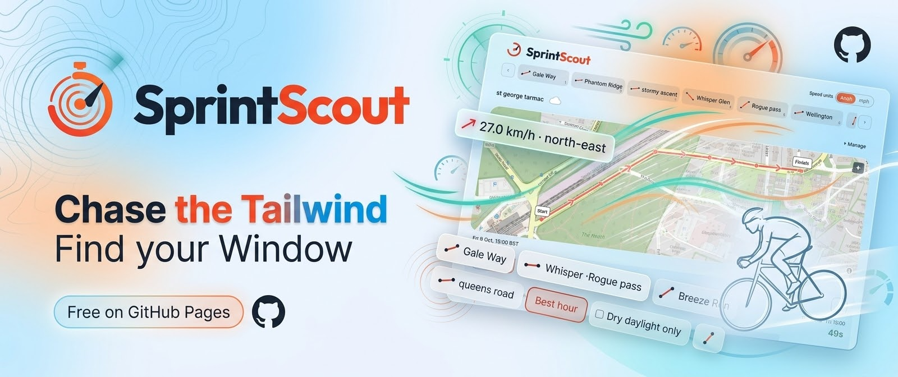

# SprintScout



[](https://newell-paul.github.io/sprint-scout/dashboard/) [](https://newell-paul.github.io/sprint-scout/dashboard/) [](https://newell-paul.github.io/sprint-scout/dashboard/) [](https://newell-paul.github.io/sprint-scout/dashboard/) [](https://newell-paul.github.io/sprint-scout/dashboard/)

A browser-only planner for timing cycling segment attempts to the wind. Draw a segment, and SprintScout pulls 48 hours of wind from Open-Meteo, projects it onto every leg, and shows the hour with the most tailwind and the seconds a reference rider would gain. Add terrain and shelter per segment, set a target time, and the board ranks every saved segment by its best hour. Import a GPX ride and it finds your own traversals and, on request, the wind that hour from the archive.

Segments stay in local storage. No accounts, API keys or server. Wind, elevation and map tiles come from Open-Meteo and OpenStreetMap. Saving a segment confirms it is your own and permits sending its start coordinate for wind; elevation and past wind each have a separate consent box. Estimates are physics for a reference rider, not a prediction of your time.

## Try it

Live at <https://newell-paul.github.io/sprint-scout/>, or run it locally:

```sh
pnpm install --frozen-lockfile
pnpm --filter @scout/web dev
```

Open <http://127.0.0.1:3000>. A short example segment in Richmond Park is loaded on first visit; pick an hour, then delete it from Manage and draw your own.

Node 26 (`nvm use`) and pnpm 10.30.3.

To test on a phone on the same network, run `DEV_ORIGINS=<your LAN IP> pnpm --filter @scout/web exec next dev --hostname 0.0.0.0` and open `http://<your LAN IP>:3000`.

## Dashboard

Every push to `main` builds an [engineering dashboard](https://newell-paul.github.io/sprint-scout/dashboard/) from the run's own reports: pipeline, tests per level, quality gates, Lighthouse and bundle size, evals and intents, delivery. Static HTML with inline SVG, no scripts, light and dark. The badges above read its `badges/*.json`. Source in `packages/testing/src/dashboard.ts`; build locally with `pnpm dashboard` from whatever reports exist.

## Publishing

`.github/workflows/pages.yml` publishes a static export to GitHub Pages on every push to `main`. Enable Pages with the "GitHub Actions" source once. Build locally with `pnpm --filter @scout/web build:static` (output in `apps/web/out`).

## Checks

```sh
pnpm lint && pnpm typecheck && pnpm test   # quick gates
pnpm check:static        # eslint, prettier, markdownlint, cspell, dependency boundaries, knip, tsc, type-coverage
pnpm test:coverage       # vitest with coverage gates
pnpm test:component      # components in real Chromium with ARIA snapshots and axe
pnpm test:e2e            # Playwright (run `pnpm exec playwright install chromium` first)
pnpm test:visual         # screenshot baselines (Linux; CI or the Playwright container)
pnpm test:mutation       # StrykerJS, incremental
pnpm test:integration    # migrate and seed against a throwaway Postgres (needs Docker)
pnpm check:deploy        # static export smoke, size-limit, Lighthouse budgets
```

Gate configuration lives in the respective config files at the repo root. The full strategy, fixtures and CI layout are in [docs/test-strategy.md](docs/test-strategy.md).

## Beyond the planner

The repo also holds a synthetic demo planner with a Fastify API, a local PostGIS database and the wind engine benchmark. None of it is needed to use or publish the planner.

- `pnpm dev` starts web and API together. Demo at `/demo`; API at <http://127.0.0.1:3001>. Both use invented routes and fixed-clock forecasts, loopback only.
- `docker compose up -d --wait && pnpm db:migrate && pnpm db:seed` for the database. Commands refuse non-loopback hosts. `.env.example` documents the only value.
- `pnpm benchmark:wind` runs the synthetic 50-segment, 48-hour ranking benchmark.
- `LIVE_WEATHER_SMOKE=1 pnpm test:weather:live` makes one real Open-Meteo request; skipped by default.

Design, decisions and status: [docs/design.md](docs/design.md), [docs/integration-decisions.md](docs/integration-decisions.md), [docs/implementation-plan.md](docs/implementation-plan.md), [docs/validation.md](docs/validation.md), [docs/sdlc.md](docs/sdlc.md).

## Licence

MIT. See [LICENSE](LICENSE).
